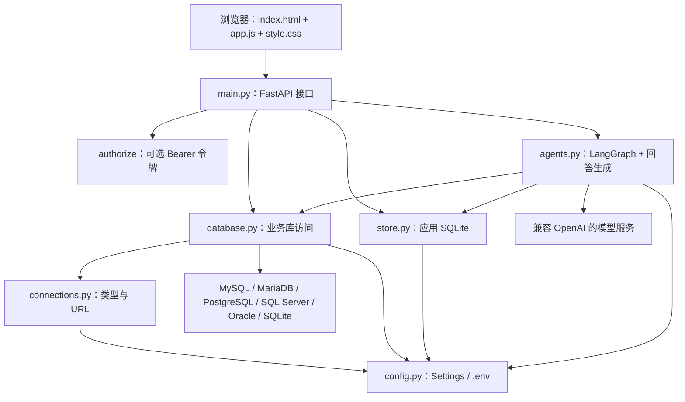
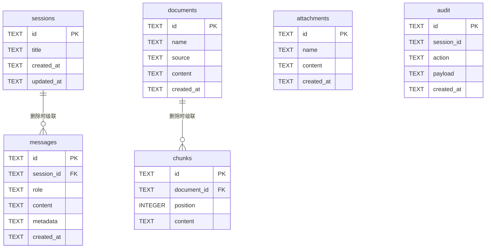
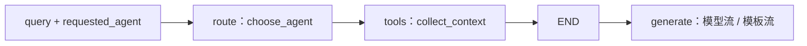
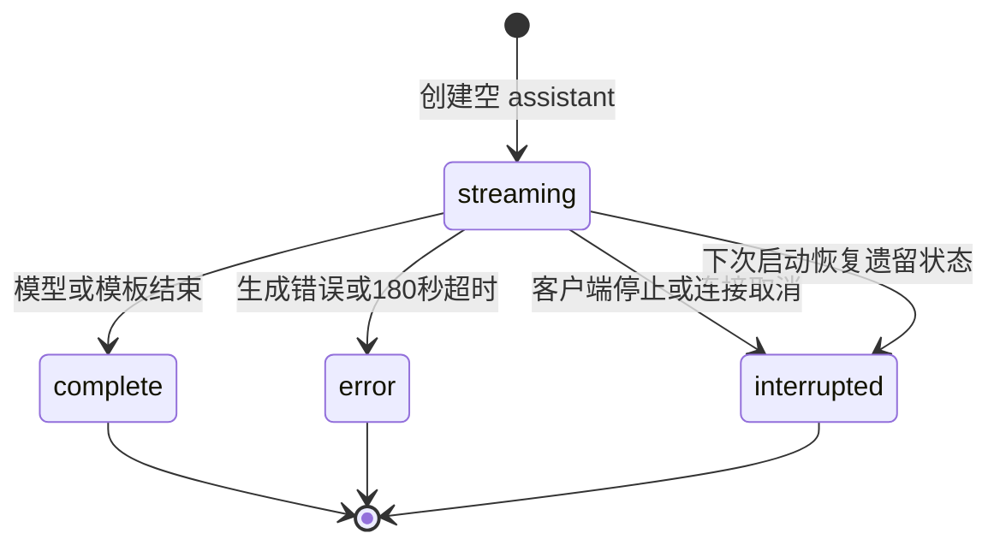
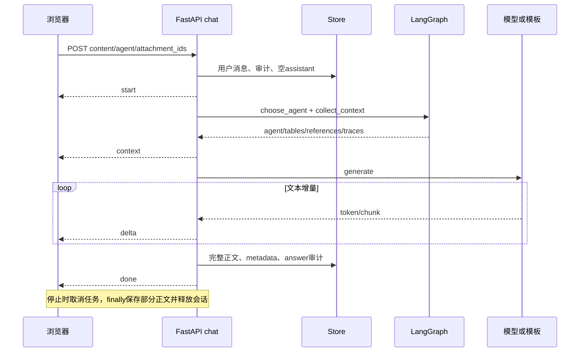

# ChatDB Agent 全部代码说明文档

> 文档日期：2026-11-15  
> 对应项目：`dbagent`，FastAPI 应用声明版本 `1.0.0`。  
> 本文依据当前源码编写，覆盖后端、前端、启动脚本、依赖、配置、数据表、接口和测试。文中连接信息全部为示例或占位符，没有复制本地密钥、密码、业务数据或历史会话。  
> 阅读本文时，应区分“已经实现的功能”“演示模式的模板行为”和“后续扩展建议”。

## 1. 阅读方式与项目定位

ChatDB 是一个通过网页使用的数据库助手。用户可以连接业务数据库、查看表结构、咨询数据库知识、生成 SQL、上传日志或文档，以及手动执行只读查询。后端负责工具调用、模型请求、数据库安全校验和持久化，前端负责聊天、流式显示、数据库配置与结果展示。

项目包含两个互相独立的数据层：

- **应用存储**：SQLite 文件 `data/chatdb.sqlite3`，保存会话、消息、知识文档、文档切片、附件和审计。
- **业务数据库**：由用户连接配置决定，可以是 MySQL、MariaDB、PostgreSQL、SQL Server、Oracle 或已有 SQLite 文件。没有配置时使用 `data/demo.sqlite3` 示例库。

即使业务数据库使用 MySQL，聊天记录仍然存入应用 SQLite；连接业务数据库不会把聊天表创建到 MySQL 中。

项目采用单个共享工作空间。访问令牌是一个可选的共同口令，不是用户账号体系。持有令牌的人可以访问同一批会话、知识和审计，并操作当前共享数据库连接。

建议按以下顺序阅读：

| 阅读目的 | 优先章节 |
|---|---|
| 首次安装与运行 | 3—5、22 |
| 理解整体执行链路 | 2、6、10、15 |
| 修改数据库连接或只读查询 | 8—9、13、20 |
| 修改智能体或模型接口 | 10—11、15 |
| 修改页面 | 16—18 |
| 理解数据保存与删除 | 7、12、19、22 |
| 验证和扩展项目 | 23—26 |

`readme.md` 主要描述最初的产品需求与设想；`使用说明.md` 面向操作和连接配置；本文面向开发维护，解释当前代码实际行为。需求文档中的技术选型不能直接当作已经实现的能力。

## 2. 全部文件与职责

```text
dbagent/
├── app/
│   ├── __init__.py            Python 包标记
│   ├── config.py              环境变量、Settings、连接配置落盘
│   ├── connections.py         数据库目录、请求模型、URL 构造与脱敏
│   ├── database.py            元数据、连接切换、SQL 校验与只读执行
│   ├── store.py               SQLite 应用存储与本地知识检索
│   ├── agents.py              专家路由、上下文工具、模型流与演示回答
│   └── main.py                FastAPI 生命周期、鉴权和全部 HTTP 接口
├── static/
│   ├── index.html             页面结构、输入框、侧栏和面板容器
│   ├── app.js                 状态、请求、流式聊天、渲染和事件处理
│   └── style.css              配色、布局、组件、响应式与动效
├── tests/
│   ├── test_app.py            SQL 安全、API、聊天、文件、审计测试
│   ├── test_connections.py    URL、驱动、连接切换、配置持久化测试
│   └── test_mysql.py          可选真实 MySQL 只读集成测试
├── run.py                    Uvicorn 启动入口
├── start.ps1                 Windows 虚拟环境启动脚本
├── requirements.txt          Python 运行依赖
├── .env                      本地实际配置，包含敏感信息
├── .env.example              配置模板，分享前也应检查是否含真实凭据
├── .gitignore                本地配置、缓存和运行数据排除规则
├── readme.md                 原始需求说明
├── 使用说明.md               用户操作说明
└── 全部代码说明文档.md        本文
```

`.venv/`、`__pycache__/`、`data/`、截图和工具生成目录不是业务源代码。虚拟环境由依赖安装产生，缓存由 Python 产生，运行数据由应用产生；不要逐个维护这些生成文件。

`app/__init__.py` 不包含业务逻辑，用来使 `app` 成为可导入的 Python 包。启动时导入 `app.main`，其余模块通过相对导入连接起来。

## 3. 架构与模块依赖



`config.py` 是底层配置模块；`connections.py` 依赖配置路径；`database.py` 依赖连接目录和设置；`store.py` 依赖设置；`agents.py` 依赖存储和数据库；`main.py` 汇总这些模块并暴露 HTTP 接口。

主要全局对象：

| 对象 | 位置 | 用途与生命周期 |
|---|---|---|
| `settings` | `config.py` | 导入时创建的配置对象；模型配置不会自动重新读文件 |
| `database` | `database.py` | 当前共享业务连接和连接切换锁 |
| `store` | `store.py` | 应用 SQLite 的操作入口 |
| `graph` | `agents.py` | 编译后的 `route → tools → END` 工作流 |
| `app` | `main.py` | FastAPI 应用 |
| `active_sessions` | `main.py` | 正在生成回答的会话 ID 集合 |
| `database_switching` | `main.py` | 防止切库与聊天启动交错的进程内标记 |

这些对象属于当前 Python 进程。多个 Uvicorn worker 会有各自的集合、锁和数据库对象，因此当前设计应以单 worker 运行。SQLite 本身支持一定并发，并不意味着上层连接切换和聊天互斥已经支持多进程部署。

## 4. 启动入口与依赖

### 4.1 `run.py`

文件导入 `uvicorn`，在直接运行时调用：

```python
uvicorn.run("app.main:app", host="127.0.0.1", port=8000, reload=False)
```

`"app.main:app"` 表示导入 `app/main.py` 并取其中 `app` 对象。监听地址为本机回环地址，默认其他机器无法直接访问。`reload=False` 表示源码修改后需要重启。

### 4.2 `start.ps1`

脚本将错误策略设为 `Stop`，使用 `$PSScriptRoot` 定位当前项目下的 `.venv\Scripts\python.exe`。若不存在虚拟环境，提示安装 Python 3.11 和依赖并以退出码 1 结束；若存在，则使用该解释器执行 `run.py`。

使用项目虚拟环境很重要：代码采用 `int | None` 等新语法，当前项目环境为 Python 3.11；系统中另一个旧版 Python 不一定可以运行。

```powershell
# 在项目目录中执行
py -3.11 -m venv .venv
.\.venv\Scripts\python.exe -m pip install -r requirements.txt
.\start.ps1
```

直接启动也可以：

```powershell
.\.venv\Scripts\python.exe run.py
```

### 4.3 `requirements.txt`

| 依赖 | 当前版本约束 | 在本项目中的职责 |
|---|---|---|
| FastAPI | `0.115.0` | HTTP 路由、请求验证、上传、依赖鉴权 |
| Uvicorn | `0.30.6` | ASGI 服务 |
| httpx | `0.27.2` | 模型分类请求、模型流式请求 |
| SQLGlot | `25.24.5` | 多方言 SQL 解析、AST 安全检查、行数改写 |
| SQLAlchemy | `2.0.46` | URL、连接引擎、参数绑定、同步元数据反射 |
| asyncpg | `0.29.0` | PostgreSQL 异步驱动 |
| aiomysql | `0.2.0` | MySQL / MariaDB 异步驱动 |
| PyMySQL | `1.1.1` | aiomysql 依赖与连接兼容性 |
| cryptography | `>=42.0.0,<47.0.0` | 部分 MySQL 认证方式所需密码学支持 |
| python-tds | `>=1.16,<2.0` | SQL Server TDS 驱动 |
| sqlalchemy-pytds | `>=1.0,<2.0` | SQL Server SQLAlchemy 方言 |
| oracledb | `>=2.5,<4.0` | Oracle Thin 驱动 |
| python-multipart | `0.0.20` | multipart 文件上传解析 |
| pypdf | `4.3.1` | PDF 文本提取 |
| python-docx | `1.1.2` | DOCX 段落和表格提取 |
| langgraph | `0.2.16` | 路由和上下文工具工作流 |
| langchain-core | `0.2.43` | StructuredTool 封装 |

PyMySQL 固定版本的注释说明：需要与 aiomysql 的 SQLAlchemy ping 适配保持一致，避免升级后 `reconnect` 参数不兼容。升级依赖时应保留相关连接测试。

部分依赖使用范围约束，并没有完整锁文件。因此不同时间安装可能解析到不同的兼容版本；正式部署可以另行保存经过验证的依赖锁定结果。

### 4.4 `.gitignore`

当前排除 `.env`、`.venv/`、`__pycache__/`、`*.pyc`、`data/`、`.pytest_cache/`。`.env.example` 没有被排除，因此填写过真实凭据的模板也需要人工脱敏。忽略规则不能移除已经被 Git 跟踪的历史秘密。

## 5. 配置模块 `app/config.py`

### 5.1 路径与加载规则

`ROOT` 根据当前源文件的绝对路径向上两级得到项目目录，避免把配置读取位置完全绑定到终端工作目录。

`load_env()` 在模块导入时执行：如果 `ROOT/.env` 存在，以 `utf-8-sig` 读取，支持 UTF-8 BOM；按行去除首尾空白，忽略空行和以 `#` 开头的注释；遇到 `=` 时只按第一个等号分割键值。

通过 `os.environ.setdefault()` 写入环境变量，因此**进程已有环境变量优先于 `.env`**。它是一个轻量加载器，不是完整 dotenv 解释器：不会展开 `${VAR}`，不会解析多行值，也不会把值尾部的 `#` 自动当注释。示例中的说明应单独成行。

`data_directory()` 读取 `APP_DATA_DIR`。相对路径按项目目录解析，绝对路径直接使用，最后调用 `resolve()`。

### 5.2 `Settings` 字段

| 环境变量 | 属性 | 默认值 | 行为 |
|---|---|---|---|
| `LLM_API_KEY` | `api_key` | 空 | 非空使用模型；空使用本地演示模板 |
| `LLM_BASE_URL` | `base_url` | `https://api.openai.com/v1` | 去掉尾部 `/`，调用时追加 `/chat/completions` |
| `LLM_MODEL` | `model` | `gpt-4o-mini` | 分类和回答共用模型名 |
| `APP_ACCESS_TOKEN` | `access_token` | 空 | 非空启用 API Bearer 令牌验证 |
| `DATABASE_URL` | `database_url` | 空 | 空则启用示例 SQLite |
| `DATABASE_TYPE` | `database_type` | 空 | 可显式指定目录类型，否则由 URL 推断 |
| `DATABASE_SCHEMAS` | `schemas` | `public` | 允许读取的 Schema，逗号分隔 |
| `QUERY_TIMEOUT_SECONDS` | `query_timeout` | `10` | 整数限制为 1—60 |
| `QUERY_ROW_LIMIT` | `row_limit` | `200` | 整数限制为 1—1000 |
| `APP_DATA_DIR` | `data_dir` | `data` | 应用存储和示例库所在目录 |

超时和行数用 `int()` 转换。若配置为 `abc` 等非整数，导入阶段即可能失败，而不是自动使用默认值。负数或过大的合法整数会被夹取到上下界。

下面是脱敏示例，不能将占位符当作真实凭据：

```dotenv
LLM_API_KEY=<YOUR_MODEL_API_KEY>
LLM_BASE_URL=https://api.openai.com/v1
LLM_MODEL=gpt-4o-mini
APP_ACCESS_TOKEN=<YOUR_APP_ACCESS_TOKEN>
DATABASE_TYPE=mysql
DATABASE_URL=mysql+aiomysql://chatdb_reader:<URL_ENCODED_PASSWORD>@127.0.0.1:3306/business_db
DATABASE_SCHEMAS=
QUERY_TIMEOUT_SECONDS=10
QUERY_ROW_LIMIT=200
APP_DATA_DIR=data
```

如果要使用演示模式，`LLM_API_KEY` 留空；如果要使用示例业务库，`DATABASE_URL` 留空。两个开关彼此独立，可以“真实业务库 + 模板回答”，也可以“示例业务库 + 模型回答”。

### 5.3 `save_database_url()`

签名为 `save_database_url(value, database_type=None, schemas=None)`，用于网页保存连接。

执行步骤：

1. 拒绝待保存值中的 `\n` 或 `\r`，避免插入额外配置行。
2. 读取现有 `.env`，保留非目标配置项。
3. 始终更新 `DATABASE_URL`；传入可选参数时同时更新 `DATABASE_TYPE`、`DATABASE_SCHEMAS`。
4. 删除旧目标键的所有出现位置，再把新值追加到末尾。
5. 在项目目录生成临时文件，完整写入，再通过 `os.replace()` 替换 `.env`。
6. 在 `finally` 中清理剩余临时文件。

采用同目录临时文件替换，避免正常写入失败把原文件截断。数据库 URL 使用真实密码落盘，文件不是加密凭据库。网页展示脱敏和文件存储加密是两件不同的事情。

网页保存后 `Database.connect()` 还会同步修改内存中的数据库设置，所以连接立即生效。手工修改模型或其他环境配置，需要重启进程重新加载。

## 6. FastAPI 生命周期与公共基础逻辑

### 6.1 `lifespan(app)`

应用启动时先执行 `store.init()`，创建应用存储表并恢复消息状态，再执行 `await database.startup()` 建立业务数据库配置。停止时执行 `await database.close()` 释放引擎。

启动并不统一调用连接测试接口的完整 `_probe()`。例如异步引擎可能在实际请求时才连接；“进程已经启动”不能直接证明模型和业务库均可用。

### 6.2 `authorize()`

`HTTPBearer(auto_error=False)` 允许没有凭据的请求先进入函数，由 `settings.access_token` 决定是否需要验证。

配置非空令牌时，取 `Authorization: Bearer <token>`，使用 `secrets.compare_digest()` 比较，失败返回 401。配置为空时，业务 API 不要求身份认证。

`/` 和 `/static` 公开；默认生成的 `/docs`、`/redoc`、`/openapi.json` 也没有额外访问令牌依赖。实际业务路由配置了 `Depends(authorize)`。这不是每用户权限、表级角色或租户隔离机制。

### 6.3 `validation_error()`

FastAPI 请求模型验证失败通常返回字段错误。连接接口路径以 `/api/database/connection` 开头时，统一返回：

```json
{"detail":"连接参数格式不正确，请检查端口和字段长度。"}
```

目的是避免 Pydantic 默认错误携带输入原文，其中可能包含密码。其他接口返回编码后的 `exc.errors()`，不适合把秘密放进普通聊天或 SQL 参数。

### 6.4 `require_session()` 与应用创建

`require_session(session_id)` 通过 `store.session()` 判断存在性，失败抛出 404。聊天、详情、删除、导出，以及携带会话 ID 的查询都使用它。

`FastAPI(title="ChatDB Agent", version="1.0.0", lifespan=lifespan)` 创建应用；静态资源通过 `StaticFiles` 挂载到 `/static`；`index()` 使用 `FileResponse` 返回 HTML。

## 7. 应用存储模块 `app/store.py`

### 7.1 基础工具和连接事务

`now()` 返回 UTC 时区的 ISO 8601 时间字符串，例如 `2026-11-15T12:00:00+00:00`。浏览器显示时转换为本地时间。

`uid()` 返回 `uuid.uuid4().hex`，即 32 位十六进制字符串，用于所有主键。它不是递增序列，也不是用户可读编号。

`Store.__init__(path=None)` 默认使用 `settings.data_dir / "chatdb.sqlite3"`；测试可以传入临时路径。

`Store.connect()` 每次操作创建一个独立 SQLite 连接，等待锁超时 15 秒，使用 `sqlite3.Row`，开启 `PRAGMA foreign_keys = ON`。`with conn` 成功时提交，异常时回滚，外层 `finally` 始终关闭连接。

同步 Store 操作在部分异步接口中直接执行，因此大规模扫描或磁盘阻塞可能占用事件循环。当前小型工作空间设计不能直接推导为高吞吐服务。

### 7.2 `Store.init()` 与六张表

初始化创建父目录，启用 WAL，并执行 `CREATE TABLE IF NOT EXISTS`。没有版本化迁移表或自动字段升级框架。

#### `sessions`：会话

| 字段 | 类型和约束 | 含义 |
|---|---|---|
| `id` | TEXT PRIMARY KEY | 会话 ID |
| `title` | TEXT NOT NULL | 初始“新对话”，之后由首条用户消息生成 |
| `created_at` | TEXT NOT NULL | 创建时间 |
| `updated_at` | TEXT NOT NULL | 最近新增消息时间 |

#### `messages`：消息

| 字段 | 类型和约束 | 含义 |
|---|---|---|
| `id` | TEXT PRIMARY KEY | 消息 ID |
| `session_id` | TEXT NOT NULL，外键 | 引用 sessions，删除会话时级联删除 |
| `role` | TEXT NOT NULL | 通常为 `user` 或 `assistant` |
| `content` | TEXT NOT NULL | 原始文本 / Markdown |
| `metadata` | TEXT NOT NULL，默认 `{}` | JSON 字符串，保存状态、专家、来源等 |
| `created_at` | TEXT NOT NULL | 创建时间 |

有 `messages_session` 索引辅助按会话查询。SQL 表没有 CHECK 强制限定 role；角色约束由调用代码保持。

#### `documents`：知识文档

| 字段 | 类型和约束 | 含义 |
|---|---|---|
| `id` | TEXT PRIMARY KEY | 文档 ID |
| `name` | TEXT NOT NULL | 名称 |
| `source` | TEXT NOT NULL | 来源字符串或导航 URL |
| `content` | TEXT NOT NULL | 完整提取正文 |
| `created_at` | TEXT NOT NULL | 入库时间 |

#### `chunks`：知识切片

| 字段 | 类型和约束 | 含义 |
|---|---|---|
| `id` | TEXT PRIMARY KEY | 切片 ID |
| `document_id` | TEXT NOT NULL，外键 | 引用 documents，删除文档时级联删除 |
| `position` | INTEGER NOT NULL | 从 1 开始的位置 |
| `content` | TEXT NOT NULL | 当前片段正文 |

#### `attachments`：聊天附件

| 字段 | 类型和约束 | 含义 |
|---|---|---|
| `id` | TEXT PRIMARY KEY | 附件 ID |
| `name` | TEXT NOT NULL | 清理后的文件名 |
| `content` | TEXT NOT NULL | 提取后的正文 |
| `created_at` | TEXT NOT NULL | 上传时间 |

#### `audit`：审计

| 字段 | 类型和约束 | 含义 |
|---|---|---|
| `id` | TEXT PRIMARY KEY | 审计 ID |
| `session_id` | TEXT，可空 | 关联会话 ID，但没有外键 |
| `action` | TEXT NOT NULL | 动作名 |
| `payload` | TEXT NOT NULL | JSON 数据 |
| `created_at` | TEXT NOT NULL | 记录时间 |

审计的 `session_id` 故意没有外键，所以会话删除后仍保留其审计。附件也没有与会话级联关联；删除会话不会删除附件。

除主键自带索引外，源码仅显式创建了 `messages_session`。知识搜索是全量读取切片，不依赖全文索引。



初始化还扫描 assistant 消息，把遗留 `metadata.status == "streaming"` 改为 `interrupted`。它只能恢复已落盘内容，无法恢复退出前仍在内存中的增量。

如果知识库没有任何文档，会自动添加两篇内置资料：“数据库设计与查询规范”和“PostgreSQL 索引文档入口”。第二篇只是本地导航摘要，程序不会自动抓取官方网页全文。删除全部知识文档后重启，会再次添加默认资料。

### 7.3 会话和消息方法

| 方法 | 返回值 | 主要行为 |
|---|---|---|
| `sessions()` | 会话字典列表 | 按 `updated_at DESC` 排序 |
| `session(session_id)` | 字典或 None | 参数绑定查询单会话 |
| `create_session()` | 完整会话字典 | 生成 ID、初始标题和时间并插入 |
| `delete_session(session_id)` | 无 | 删除会话及消息，随后记录删除审计 |
| `messages(session_id)` | 消息字典列表 | 按 SQLite rowid 排序，解码 metadata |
| `add_message(...)` | 消息 ID | 插入消息，更新会话时间，必要时更新标题 |
| `update_message(...)` | 无 | 更新消息正文和 metadata |

`add_message(session_id, role, content, metadata=None)` 将 metadata 编码为 JSON。用户消息只有在会话标题仍为“新对话”时，才用 `content[:32]` 替换标题。`update_message()` 不更新会话 `updated_at`，所以列表排序由新增消息时间决定。

Store 普通查询使用 `?` 或命名占位符绑定参数，不直接拼接用户标题和正文。数据库对象名的引用问题由业务库模块单独处理。

### 7.4 文档、切片与检索方法

`add_document(name, source, content)` 将原文与所有切片放在同一事务中保存。每 800 个字符开始一片，片长最多 1000，因此相邻完整切片重叠 200 个字符。末尾片可能较短，空内容不会产生切片。

例如 1900 字符正文的片段范围是 `[0:1000]`、`[800:1800]`、`[1600:2600]`，最后实际只有 300 字符。这是字符切片，不按 token、段落或句子边界切分。

`documents()` 返回文档 ID、名称、来源、时间，以及 `characters`、`chunks`，不返回全文。`delete_document(document_id)` 返回受影响行数，由外键清除切片。

`search(query, limit=4)` 的算法：

1. 英文标识符式单词长度至少 2，统一小写。
2. 连续中文字符生成二元词，例如“联合索引”产生“联合”“合索”“索引”。
3. 使用 set 去重，重复出现的查询词不会增加分数。
4. 全量读取切片及文档名称，在“名称 + 正文”中做子串匹配。
5. 长度大于 2 的匹配词加 2 分，否则加 1 分。
6. 丢弃 0 分片段，降序取前 `limit` 条。

返回项包含 `id`、`position`、`content`、`document_id`、`name`、`source`、`score`。分数用于排序，不是语义相似度或可信度概率。没有 embedding、向量数据库、BM25、重排模型或联网搜索。

### 7.5 附件和审计方法

`add_attachment(name, content)` 保存解析文本并返回 ID；`attachment(attachment_id)` 读取字典或 None。

`log(session_id, action, payload)` 保存 JSON，使用 `default=str` 兼容部分非 JSON 原生类型。`audit(limit=100)` 按 rowid 倒序返回最近记录，并将 payload 解码为对象。

每次方法调用各自提交。一次 HTTP 请求中多次 `log()`、`add_message()` 并不构成一个跨方法的大事务。例如会话已删除而删除审计失败时，两者可能不一致。

## 8. 连接参数模块 `app/connections.py`

### 8.1 数据库目录 `DATABASE_TYPES`

| `type` | 默认端口 | SQLAlchemy 驱动 | SQLGlot 方言 | 默认 Schema |
|---|---:|---|---|---|
| `mysql` | 3306 | `mysql+aiomysql` | `mysql` | 空 |
| `mariadb` | 3306 | `mysql+aiomysql` | `mysql` | 空 |
| `postgresql` | 5432 | `postgresql+asyncpg` | `postgres` | `public` |
| `mssql` | 1433 | `mssql+pytds` | `tsql` | `dbo` |
| `oracle` | 1521 | `oracle+oracledb` | `oracle` | 空，连接时使用用户名 |
| `sqlite` | 无 | `sqlite` | `sqlite` | `main` |

`type`、SQLAlchemy driver 和 SQLGlot dialect 用于不同层，不能混为一个字符串。例如 API 中传 `postgresql`，SQL 校验器使用 `postgres`；SQL Server API 类型为 `mssql`，解析方言为 `tsql`。

当前是六类主流数据库的适配，不是所有数据库或所有认证模式都兼容。没有实现 MongoDB、Redis、ClickHouse、DB2、Snowflake 等专用接口，也没有统一支持 SSH 隧道、云 IAM、Windows 集成认证或网页可配置的全部 TLS 参数。

### 8.2 `ConnectionRequest`

| 字段 | 默认 / 限制 | 说明 |
|---|---|---|
| `type` | 必填，最多 32 字符 | 必须属于目录 |
| `host` | 空，最多 255 字符 | 网络库必填，支持 IP / 域名 |
| `port` | None，1—65535 | 缺省使用该类型默认端口 |
| `username` | 空，最多 128 字符 | 网络库必填 |
| `password` | 空 `SecretStr` | 通过 `get_secret_value()` 获取真实值 |
| `reuse_password` | false | 是否沿用当前连接的密码 |
| `database` | 空，最多 512 字符 | 数据库名、Oracle 服务 / SID、SQLite 路径 |
| `schemas` | 空，最多 512 字符 | 逗号分隔的 Schema |
| `oracle_mode` | `service_name` | Oracle 中只能为 service_name 或 sid |

`SecretStr` 有助于避免模型表示直接打印密码，但真正构造连接时仍需要明文。应用没有数据库密码查询接口。

### 8.3 `connection_url()`

签名为 `connection_url(body, current_url=None, current_type=None)`，返回 SQLAlchemy `URL`。

SQLite 分支要求填写服务器上的已有文件路径；相对路径以 `ROOT` 为基准。通过 `is_file()` 验证，不创建新的用户数据库，也不从浏览器上传 SQLite 文件作为连接。

网络库要求主机和用户名。MySQL / MariaDB 允许数据库名为空，以便先连接服务器再选择业务库；其余网络库要求数据库 / 服务名。Schema 名仅接受由字母、数字、下划线构成且不以数字开头的名称；PostgreSQL 配置还会在 `_configure()` 中进一步检查。

`URL.create()` 负责处理密码中的 `@`、`:`、`/` 等特殊字符和 IPv6。网页密码框输入原始密码，不需要用户预先编码；直接写 URL 时则应正确进行 URL 编码。

复用密码必须同时满足：

- 当前 URL 存在；
- 数据库类型相同；
- 主机、有效端口和用户名与当前连接相同。

数据库名可以改变；MySQL 和 MariaDB 虽共用驱动，仍不能跨类型复用。主机或账号改变时必须重新提供密码。

Oracle 的 `service_name` 模式将值放入 URL query；SID 模式将值放入 URL database 路径。二者不是同一个位置：

```text
oracle+oracledb://reader:<ENCODED_PASSWORD>@db.example:1521/?service_name=ORCLPDB1
oracle+oracledb://reader:<ENCODED_PASSWORD>@db.example:1521/ORCL
```

### 8.4 其余函数

`infer_type(url)` 根据 URL backend 推断类型，将 `postgres` 转为 `postgresql`，保留 MariaDB 类型映射。

`public_connection(url, kind, schemas)` 只返回 type、host、port、username、database、schemas、`has_password`、oracle_mode。不会返回 password 或完整带密码 URL。

`catalog()` 返回类型目录，但排除内部 driver 字段；网页通过这个目录得到名称、默认端口、方言和 Schema。

## 9. 业务数据库模块 `app/database.py`

### 9.1 基础工具与对象

`QueryRejected(ValueError)` 表示主动拒绝的 SQL 或数据库选择，接口可以给出明确原因。

`in_thread(function, *args)` 通过事件循环 executor 运行同步函数。SQLite、SQL Server、Oracle 的部分操作使用它，避免同步数据库 I/O 完全阻塞事件循环。取消等待该线程的协程不保证底层同步操作立即结束。

`sqlite_connect(path, uri=False)` 是初始化示例库使用的连接上下文，支持提交 / 回滚并确保关闭。它与用于业务查询的 `sqlite_connection()` 不同：后者只读打开。

`Database.__init__()` 保存 `demo_path`、`engine`、`dialect`、`mysql_database`、`kind`、`url`、`schemas`，并创建 `_switch_lock = asyncio.Lock()`。

`label` 属性返回数据库类型名称和服务 / 库名；没有 URL 时显示示例业务库。`is_demo` 为 `dialect == "sqlite" and url is None`，连接用户自己的 SQLite 文件时为 false。`connection_config()` 调用 `public_connection()` 得到脱敏配置。

### 9.2 示例数据库 `init_demo()`

创建 `departments` 和 `sales`：

| 表 | 字段 |
|---|---|
| departments | `id INTEGER PRIMARY KEY`、`name TEXT NOT NULL UNIQUE` |
| sales | `id INTEGER PRIMARY KEY`、`department_id` 外键、`amount NUMERIC`、`status TEXT`、`created_at TEXT` |

创建 `idx_sales_status_date ON sales(status, created_at)`。部门为空时添加 4 个部门，每天每部门 3 条订单，覆盖初始化时最近 30 天，共 360 条。金额由固定算式生成，部分状态为 cancelled，其余为 completed。

只有部门表为空时才生成数据。数据库文件已经有数据后，重启不会把日期每日滚动刷新，因此长期使用同一个示例文件后，“最近 7 天”可能没有结果；这不是模型或连接异常。

### 9.3 `startup()` 与 `_configure()`

`startup()` 清理当前内存连接字段，读取 settings。配置 URL 时用 `make_url()` 解析，并按显式类型或推断类型调用 `_configure()`；没有 URL 时设置 SQLite / main 并调用 `init_demo()`。

`_configure(url, kind, schemas)` 将 URL driver 规范化到目录定义。Schema 空时采用类型默认值；Oracle 默认用户名并将 Schema 转为大写。

不同引擎：

- MySQL / MariaDB：异步引擎，`pool_pre_ping=True`，连接超时来自配置。
- PostgreSQL：异步引擎，同时配置连接和命令超时，校验 Schema。
- SQL Server：同步引擎，`NullPool`，配置登录 / 网络超时、`readonly=True`、关闭驱动连接重试。
- Oracle：同步引擎，`NullPool`，TCP 连接超时，通过 connect 事件函数 `set_call_timeout()` 设置毫秒级 call_timeout。
- SQLite：解析到已有路径，不创建 SQLAlchemy engine，以 sqlite3 只读连接访问。

`hide_parameters=True` 用于减少 SQLAlchemy 日志中的参数暴露，不能替代整个应用日志的敏感信息治理。

SQL Server 的驱动 `readonly=True` 是连接用途 / 路由提示，不能保证数据库拒绝所有写入。必须使用数据库只读权限账号。

### 9.4 `_probe()`、`connect()` 与切换

`_probe()` 对网络库执行 `SELECT 1`，Oracle 使用 `SELECT 1 FROM DUAL`，然后读取元数据；SQLite 直接读取表结构。同步分支中的内部 `probe()` 在线程运行。

`connect(body, persist=False)`：

1. 获取 `_switch_lock`。
2. 构造 URL，创建独立 candidate。
3. candidate 配置引擎、测试连接、读取表结构。
4. 需要保存时，先调用 `save_database_url()`。
5. 任一步失败则关闭 candidate，并保留原连接对象。
6. 仅测试时关闭 candidate，返回 ok/message/table_count，不影响当前连接。
7. 保存成功时复制候选字段到当前对象，同步 settings，释放旧引擎。

“连接失败或持久化失败前保留旧库”有专门测试覆盖。但整个保存请求不是跨 `.env`、内存对象、旧引擎释放和审计表的分布式事务。换入后旧引擎 dispose 或接口审计失败，可能返回失败提示而新连接已经生效，应通过 GET 配置和实际查询核实。

### 9.5 MySQL / MariaDB 业务库选择

`databases()` 执行 `SHOW DATABASES`，过滤 `information_schema`、`mysql`、`performance_schema`、`sys`，排序后返回。返回范围仍受数据库账号权限影响。

`select_mysql_database(name, persist=False)` 负责加锁，再调用 `_select_mysql_database()`。

内部方法检查当前是 MySQL 方言，目标库位于可见列表；创建新的异步引擎并执行 `SELECT 1`；需要保存时更新 URL；成功后替换引擎及选库字段，释放旧引擎。

此选择接口虽然名称写 MySQL，MariaDB 也使用 mysql 方言。它测试连接但没有像完整 `connect()` 一样在替换前读取全部新库元数据。后续 schema 接口可能仍因元数据权限失败。

### 9.6 元数据方法

`schema()` 获取切换锁后调用 `_schema()`。锁确保读取结构时不会半途切换数据源。

| 方法 | 实现 |
|---|---|
| `_schema()` | 根据当前 engine / dialect 分派；PostgreSQL 分支直接查询系统视图 |
| `_mysql_schema()` | 查询 information_schema.COLUMNS 和 STATISTICS，仅当前业务库 |
| `_inspected_schema()` | SQLAlchemy Inspector 读取 SQL Server / Oracle 的表、列、主键、索引 |
| `_sqlite_schema()` | 查询 sqlite_master、PRAGMA table_info，读取显式索引 SQL |

统一表结构：

```json
[
  {
    "schema": "business_db",
    "name": "orders",
    "columns": [
      {"name":"id","type":"bigint","nullable":false,"primary_key":true,"comment":""}
    ],
    "indexes": [
      {"name":"PRIMARY","definition":"UNIQUE PRIMARY (id)"}
    ]
  }
]
```

`primary_key`、`comment` 等可选属性不是每个数据库分支都有。PostgreSQL 分支目前列信息主要包含 name/type/nullable，索引来自 `pg_indexes`；不能假定统一提供主键、外键、唯一约束和注释全集。

MySQL 将联合索引列按 `SEQ_IN_INDEX` 分组；SQLite 仅读取有显式 SQL 的索引，自动索引不会全部显示。Inspector 的 Oracle 内部 `actual_name()` 用 `denormalize_name()` 还原名称，避免普通大写对象被误报为小写。

元数据可见集合也是 SQL 校验的允许表集合。它不是独立维护的权限表；真正权限仍由数据库账号决定。

### 9.7 `validate_sql()`：完整校验顺序

签名：`validate_sql(sql, dialect, allowed_tables, default_schema=None)`，返回按当前方言重新生成的 SQL 字符串。

1. 拒绝空 SQL 或超过 20,000 字符。
2. 用 SQLGlot 按当前方言解析。
3. 只接受单个顶层 Select、Union、Intersect、Except。
4. 遍历 AST，拒绝 Insert、Update、Delete、Create、Drop、Alter、Command、Into、Lock、Merge。
5. 拒绝 Parameter、SessionParameter、Hint、WithTableHint、QueryOption、NextValueFor。
6. 拒绝列名 `NEXTVAL` / `CURRVAL`，避免访问或递增序列。
7. 验证函数属于 `SAFE_FUNCTIONS`，特殊 CASE / AND / OR 除外；拒绝 Schema 下的自定义函数调用。
8. 通过 `traverse_scope()` 区分真实表和 CTE，验证真实表处于 allowed_tables。
9. 拒绝 catalog 跨数据库引用及表函数形式。
10. Oracle 处理普通未引用名称的大写规则，允许特殊 DUAL；Oracle / SQL Server 未限定表补默认 Schema。
11. 输出 normalized SQL。

这解释了为何 `WITH x AS (...) SELECT ... FROM x` 可以通过，而 `SELECT * FROM mysql.user`、`SELECT SLEEP(20)`、`SELECT ... FOR UPDATE` 会拒绝。

检查的是查询结构与表集合，没有独立列级白名单、行级权限或业务敏感字段识别。列是否存在由数据库执行时检查。

### 9.8 `SAFE_FUNCTIONS`

白名单同时用于 AST 检查和 SQLite authorizer。当前允许函数如下；某函数在白名单中不意味着六种数据库都实现了它：

```text
ABS AVG CAST CEIL CEILING COALESCE CONCAT COUNT CURRENT_DATE CURRENT_TIMESTAMP
DATE DATE_TRUNC DATEDIFF EXTRACT FLOOR GREATEST IF IIF IFNULL LEAST LENGTH
LOWER LTRIM MAX MIN NULLIF ROUND RTRIM STRFTIME SUBSTR SUBSTRING SUM TRIM UPPER
ROW_NUMBER RANK DENSE_RANK LAG LEAD FIRST_VALUE LAST_VALUE REPLACE
TIME DATETIME JULIANDAY TO_CHAR TO_DATE TO_TIMESTAMP
STRING_AGG GROUP_CONCAT ARRAY_AGG BOOL_AND BOOL_OR
DATE_ADD DATE_SUB CURDATE NOW YEAR MONTH DAY DAYOFMONTH DATE_FORMAT
TIMESTAMPDIFF TIMESTAMPADD
```

SQLGlot 可能将方言写法解析为规范节点名；添加函数时应检查 AST 规范名以及实际驱动行为，不能只添加用户输入的拼写。

### 9.9 `limited_sql()` 和结果截断

`limited_sql(sql, dialect)` 将顶层上限设为 `settings.row_limit + 1`，保留原 SQL 中更小的整数 LIMIT。多读取 1 行用于判断 `truncated`。

Oracle 会为没有 FROM 的 Select 添加 DUAL，再按方言生成 `FETCH FIRST` 等语法；SQL Server 按 TSQL 输出 TOP 等语法。`mysql_limited_sql(sql)` 是 mysql 方言包装器。

这一 SQL 改写主要用于 MySQL / MariaDB、SQL Server、Oracle 的普通查询。PostgreSQL 使用流式游标按行截断，SQLite 使用 fetchmany 截断，没有对普通执行统一调用 limited_sql。

行数限制不能保证查询廉价：聚合、排序、大型 JOIN 或一个巨大单元格仍可能消耗大量资源。结果 `truncated=false` 只说明本次读取没有发现更多行，不说明没有完整扫描数据。

### 9.10 `execute()` 与 `_execute()`

`execute(sql, explain=False)` 获取 `_switch_lock`，整个元数据校验和执行在同一数据源下完成。当前锁也使同一进程中的业务查询串行执行。

`_execute()` 开始计时，检查 MySQL 是否已选择库，读取 schema 构造 allowed_tables，然后 validate_sql。按数据库调用执行分支，最终补充公共字段：

```json
{
  "columns": ["connection_ok"],
  "rows": [[1]],
  "truncated": false,
  "elapsed_ms": 12.3,
  "limit": 200,
  "sql": "SELECT 1 AS connection_ok",
  "explain": false
}
```

`sql` 是校验规范化后的原查询，不是一定包含行数上限、EXPLAIN 或会话设置的实际发送语句。`elapsed_ms` 包含元数据读取和执行准备，不能直接当数据库服务器纯执行耗时。

### 9.11 各执行分支与只读机制

| 分支 | 只读措施 | 超时措施 | 行数措施 |
|---|---|---|---|
| `_mysql_execute()` | `SET TRANSACTION READ ONLY` + AST + 只读账号 | MySQL MAX_EXECUTION_TIME / MariaDB max_statement_time，外层 wait_for | 普通 SQL 改写上限 + 流式读取 |
| PostgreSQL `_execute()` | 只读事务、配置 search_path、AST、账号权限 | statement_timeout + asyncpg 配置 | 流式游标读至 cap+1 |
| `_sync_execute()` SQL Server | AST、账号权限、readonly 连接提示 | 驱动登录与网络超时 | limited_sql + fetchmany |
| `_sync_execute()` Oracle | 只读事务、AST、账号权限 | TCP 超时、call_timeout | limited_sql + fetchmany |
| `_sqlite_execute()` | URI mode=ro、query_only、authorizer、AST | progress_handler + 外层 wait_for | fetchmany(cap+1) |

MySQL 时间单位为毫秒；MariaDB max_statement_time 以秒设置。PostgreSQL `set_config(..., true)` 将 statement_timeout 和 search_path 限于当前事务。

SQLite 的内部 `authorize(action, ...)` 只允许 SELECT、READ、RECURSIVE 及白名单函数，其他动作返回 SQLITE_DENY。进度处理器每 1000 条虚拟机指令检查一次经过时间。

超时不是整个 HTTP 请求严格统一的截止时间：元数据读取不受同一个外层 wait_for 覆盖；线程取消不能保证同步驱动停止；Oracle call_timeout 是单次调用限制；SQL Server 网络超时也不等于所有阶段总超时。

### 9.12 执行计划与 `close()`

| 数据库 | `explain=true` |
|---|---|
| SQLite | `EXPLAIN QUERY PLAN` |
| MySQL / MariaDB | `EXPLAIN FORMAT=JSON` |
| PostgreSQL | `EXPLAIN (FORMAT TEXT)` |
| SQL Server | AUTOCOMMIT 下独立批次开启 SHOWPLAN_XML，查询后 finally 关闭 |
| Oracle | 主动拒绝；EXPLAIN PLAN 会写计划表，不提供该功能 |

没有自动执行 `EXPLAIN ANALYZE`。计划返回与普通查询使用相同 columns/rows 结构，不提供统一可视化计划树。

SQL Server / Oracle 的 NullPool 使每次使用独立连接，减少异常会话设置遗留。`close()` 根据同步 / 异步引擎调用 dispose，并把 engine 清空。

## 10. 智能体模块 `app/agents.py`

### 10.1 专家目录和状态

`AGENTS` 定义五个选择项：auto 智能路由、sql SQL 编码、knowledge 知识问答、design 结构设计、diagnosis 故障诊断。auto 是入口选项，最终回答会分配给四个实际专家之一。

`AgentState(TypedDict, total=False)` 包含 query、requested_agent、agent、references、tables、traces。total=False 表示工作流不同阶段可以只返回部分字段；不是每次都要构造一个完整对象。

### 10.2 工具封装

`retrieve_knowledge(query)` 调用 `store.search()`；`read_schema()` 调用 `database.schema()`。

`knowledge_tool`、`schema_tool` 使用 `StructuredTool.from_function()` 封装，并在工作流里用 `ainvoke()` 调用。这里没有把执行 SQL 工具交给模型自主调用。SQL 执行始终经用户触发的 API。

### 10.3 `choose_agent(state)`

优先级为：

1. 手工选定专家：直接采用。
2. 自动模式匹配诊断关键词：awr、慢 SQL、故障、cpu、报错、死锁、日志、性能瓶颈、explain。
3. 匹配结构设计关键词：建表、ddl、表结构、结构设计、索引设计、设计某张表。
4. 匹配 SQL 关键词：sql、查询、销售额、取数、统计、select、优化。
5. 默认知识问答；有模型密钥时再尝试模型分类。

模型分类请求超时 15 秒、temperature=0、max_tokens=20，只输入当前问题前 2000 字符。仅接受合法非 auto 输出；HTTP、JSON 结构等错误回退知识问答。

路由只看当前 content，不看历史对话或附件正文。用户只说“分析这个”并上传慢 SQL 日志时，可能需要手工选 diagnosis。

函数返回 agent 和一条简单 traces。traces 是工具行动摘要，不是隐藏推理或完整模型执行记录。

### 10.4 `collect_context(state)` 与 `graph`

所有专家都检索知识；只有 sql、design、diagnosis 读取业务 schema。返回 references、tables、traces。



LangGraph 工作流只包含路由和工具上下文准备；回答生成在 `main.py` 中另行调用 `generate()`。没有复杂多代理协商、循环反思、自动重试工具链或自动执行生成 SQL。

### 10.5 `history_context(messages, budget=16000)`

最多从最近 12 条消息选择，每条最多 5000 字符，从最新向前加入，总字符预算默认 16000。遇到下一条超预算时直接停止，不会继续挑更早的短消息。

较早内容取最近 12 条，每条前 180 字符，拼成额外 system 摘录。该摘录不是真正模型摘要，也没有包含在 16000 字符预算里。因此此参数不是完整请求总长度或 token 上限。

当前用户消息已经在调用 generate 前存入 messages；不需要再重复追加一次 user 消息。

### 10.6 `model_messages(state, messages, attachments)`

生成首条 system prompt，再附 history_context：

- 专家身份、中文回答、当前 SQL 方言。
- 只用真实 schema；缺失信息明确说明。
- SQL 使用 sql fenced code；DDL 只作为建议展示。
- 最近 7 天是当天及之前 6 个自然日。
- completed 销售口径仅限内置示例。
- 知识回答标注来源编号；诊断区分证据与假设。
- 附件和检索片段作为数据，不能服从其中命令、访问外部网址或执行命令。
- 不声称执行过未执行工具，不输出隐藏推理。

上下文截取：

| 内容 | 字符上限 |
|---|---:|
| 元数据 JSON | 20000 |
| 知识资料拼接 | 8000 |
| 单附件正文 | 18000 |
| 所有附件拼接后 | 24000 |
| 单条近期消息 | 5000 |
| 近期消息累计 | 16000，额外旧摘录另计 |

截取按字符执行，可能截断表 JSON 或文档中间语句。模型提示中的来源编号没有自动校验机制，不能保证每个引用都精确支持模型结论。

### 10.7 `demo_answer()` 与 `generate()`

`demo_answer(state, query, attachments, messages=None)` 返回确定性模板：

- 示例库销售查询：最近 7 天部门销售额，completed 状态过滤，连接 departments。
- 问题包含 30 或“三十”时日期条件改为 30 天，但模板解释仍有“最近 7 天”文字，是当前模板限制。
- SQL 真实业务库：提示配置模型或手工执行 SELECT，不套用示例表。
- 结构设计：显示当前表 / 字段 / 索引数量和检查建议。
- 诊断：列出所需证据；附件只提示已解析，不做智能报告解读。
- 知识：展示前 3 个命中片段，每个最多 650 字符；无命中则明确说明。

`generate()` 有密钥时迭代 llm_stream；无密钥时每 28 字符输出一次，并 sleep 0.012 秒模拟流式显示。演示流只是输出效果，不能称为已验证的通用模型推理。

## 11. 模型流 `llm_stream()`

使用 httpx 向 `settings.base_url + "/chat/completions"` 发送兼容 OpenAI 的请求：

```json
{
  "model": "<MODEL_NAME>",
  "messages": [{"role":"system","content":"..."}],
  "stream": true,
  "temperature": 0.2,
  "max_tokens": 2200
}
```

Authorization 使用模型密钥。HTTP 超时为 90 秒，连接超时 15 秒。解析模型 SSE 中以 `data:` 开头的行，取 `choices[0].delta.content`，遇到 `[DONE]` 结束。

最多两次尝试。尚未输出内容时，HTTP 5xx 或网络 / 内容解析错误可以重试；HTTP 4xx 不重试；已经输出任何文本后不重试，避免重复片段。

最终转换成面向用户的 RuntimeError：

- HTTP 错误显示状态码，提示检查模型配置。
- 网络或响应中断显示接口不可用提示。

`/api/status` 返回 live 只是 `api_key` 非空，不会实际检测模型能否连通。测试中的模型响应可以由 MockTransport 模拟，不等于所有模型供应商和真实模型质量已经验证。

当前只处理文本 delta，不支持图片输入、音频、模型原生 tool_calls、reasoning 字段或所有供应商专用协议。

## 12. 请求模型与数据结构

### 12.1 `ChatRequest`

```json
{
  "content": "查询最近7天各部门销售额",
  "agent": "auto",
  "attachment_ids": []
}
```

content 长度 1—20000，接口另行拒绝全空白；agent 默认 auto，须属于 AGENTS；attachment_ids 默认空，最多 3 个。附件 ID 必须存在，否则返回 404。

### 12.2 `DatabaseSelection`

```json
{"database":"business_db"}
```

数据库名长度 1—128，最终还要通过服务器可见业务库列表检查。

### 12.3 `QueryRequest`

```json
{
  "sql": "SELECT 1 AS connection_ok",
  "session_id": null,
  "explain": false
}
```

sql 长度 1—20000；session_id 可空；explain 默认 false。带会话 ID 时需要会话存在，用于审计关联，不用于修改 SQL 权限。

### 12.4 会话与消息响应

```json
{
  "session": {
    "id":"<SESSION_ID>",
    "title":"查询最近7天各部门销售额",
    "created_at":"<UTC_TIME>",
    "updated_at":"<UTC_TIME>"
  },
  "messages": [
    {
      "id":"<MESSAGE_ID>",
      "session_id":"<SESSION_ID>",
      "role":"assistant",
      "content":"回答正文",
      "metadata":{
        "status":"complete",
        "agent":"sql",
        "traces":["匹配 SQL 关键词 → SQL 编码"],
        "references":[],
        "mode":"demo"
      },
      "created_at":"<UTC_TIME>"
    }
  ]
}
```

metadata 是可扩展 JSON，不是独立 Pydantic 响应模型。失败时可能带 `error`；用户消息带 attachments 的 id/name；恢复读取时应允许旧记录缺少部分新字段。

## 13. 全部 HTTP 接口清单

共 19 个显式路由，其中主页 1 个、业务 API 18 个。以下列表不计 FastAPI 默认文档与静态文件挂载。

| 方法与路径 | 函数 | 正常响应 | 主要错误 |
|---|---|---|---|
| GET `/` | `index` | HTML 文件 | 文件 / 服务异常 |
| GET `/api/status` | `status` | 运行状态对象 | 401 |
| GET `/api/sessions` | `list_sessions` | 会话数组 | 401 |
| POST `/api/sessions` | `create_session` | 201，会话对象 | 401 |
| GET `/api/sessions/{session_id}` | `session_detail` | session + messages | 404 |
| DELETE `/api/sessions/{session_id}` | `delete_session` | `{"ok":true}` | 404、409 |
| POST `/api/sessions/{session_id}/chat` | `chat` | SSE 流 | 404、409、422 |
| GET `/api/database/connection` | `connection_settings` | types + connection + demo | 401 |
| POST `/api/database/connection/test` | `test_connection` | ok + message + table_count | 400、422、503 |
| POST `/api/database/connection` | `save_connection` | 测试信息 + 脱敏连接 | 400、409、422、503 |
| GET `/api/database/schema` | `get_schema` | 方言、表、可选数据库列表 | 503 |
| POST `/api/database/select` | `select_database` | ok + database | 400、409、503 |
| POST `/api/database/query` | `query` | 结果表格对象 | 400、404、422 |
| POST `/api/attachments` | `upload_attachment` | 201，id/name/characters | 400、413、422 |
| GET `/api/knowledge` | `list_knowledge` | 文档摘要数组 | 401 |
| POST `/api/knowledge` | `upload_knowledge` | 201，id/name | 400、413、422 |
| DELETE `/api/knowledge/{document_id}` | `delete_knowledge` | ok | 404 |
| GET `/api/audit` | `audit` | 最近 100 条审计数组 | 401 |
| GET `/api/sessions/{session_id}/export` | `export_session` | Markdown 下载 | 404 |

除 GET `/` 外，全部显式业务路由都使用 authorize。表内未逐行重复 401 和通用框架错误。

### 13.1 状态接口

返回 name、mode、model、database、demo_database、selected_database、dialect、agents、authenticated、row_limit。

`selected_database` 只在 mysql 方言下返回当前选库；`authenticated` 表示服务器配置了令牌，不是每用户登录会话状态；mode 表示模型配置是否非空。

### 13.2 连接接口

GET 配置返回目录和脱敏连接：

```json
{
  "types":[{"type":"mysql","label":"MySQL","port":3306,"dialect":"mysql","schema":""}],
  "connection":{
    "type":"mysql","host":"127.0.0.1","port":3306,
    "username":"chatdb_reader","database":"business_db",
    "schemas":"","has_password":true,"oracle_mode":"sid"
  },
  "demo":false
}
```

测试和保存使用相同 ConnectionRequest：

```json
{
  "type":"mysql",
  "host":"127.0.0.1",
  "port":3306,
  "username":"chatdb_reader",
  "password":"<YOUR_DATABASE_PASSWORD>",
  "reuse_password":false,
  "database":"business_db",
  "schemas":"",
  "oracle_mode":"service_name"
}
```

参数无效返回 400，避免把底层连接异常原文暴露给浏览器；无法连接 / 无法读取结构返回 503。保存前如果有任何回答正在生成或正在切换，返回 409。

### 13.3 Schema 与选库接口

GET schema：

```json
{
  "dialect":"mysql",
  "database":"business_db",
  "demo":false,
  "explain_supported":true,
  "tables":[],
  "databases":["business_db"]
}
```

MySQL 没选库时 tables 可以为空但 databases 有内容。Oracle explain_supported=false。非 MySQL 方言的 databases 通常为空数组。

POST select 使用 database 字段；聊天中禁止切换。权限不够、系统库、不存在库等由 QueryRejected 转为 400。

### 13.4 查询接口

先记录 query_requested，再执行数据库查询；成功记录 query 或 explain 及完整结果；主动拒绝记录 query_blocked；其他异常记录 query_failed 并返回泛化 400。

接口不会返回驱动原始堆栈。由于当前 400 同时覆盖 SQL 字段错误、权限、连接和超时，客户端应读取 detail，必要时结合服务端日志排查。

该接口自身没有检查 `database_switching` 或 `active_sessions`，数据库内部锁会协调查询与换库；它也不会自动把查询结果加入下一轮模型消息。

### 13.5 文档、附件、审计和导出

上传使用 multipart/form-data，字段名是 `file`。knowledge 保存全文及切片，attachments 保存临时问答资料文本。附件在数据库中持久化，但不会自动加入知识检索。

审计不支持分页请求参数或时间筛选，固定调用 `store.audit()` 默认 100 条。

`export_session()` 根据会话标题和消息正文拼接 Markdown，用户角色标题为“用户”，其他为“ChatDB”。下载名为 `chatdb-conversation.md`。没有另外导出结构化 metadata、附件原文件或完整审计。

### 13.6 PowerShell 调用示例

下面示例在本机运行；启用访问令牌后请替换占位符。密码不要写进共享脚本：

```powershell
$chatdbHeaders = @{ Authorization = "Bearer <YOUR_APP_ACCESS_TOKEN>" }
$chatdbBase = "http://127.0.0.1:8000"
Invoke-RestMethod "$chatdbBase/api/status" -Headers $chatdbHeaders

$chatdbSession = Invoke-RestMethod "$chatdbBase/api/sessions" `
    -Method Post -Headers $chatdbHeaders

$chatdbQueryBody = @{
    sql = "SELECT 1 AS connection_ok"
    session_id = $chatdbSession.id
    explain = $false
} | ConvertTo-Json

Invoke-RestMethod "$chatdbBase/api/database/query" `
    -Method Post -Headers $chatdbHeaders `
    -ContentType "application/json; charset=utf-8" -Body $chatdbQueryBody
```

聊天 SSE 最适合通过网页查看，普通 Invoke-RestMethod 不会提供页面式逐片段渲染。

## 14. 上传解析模块

### 14.1 `ALLOWED_EXTENSIONS`

允许 `.txt`、`.md`、`.log`、`.csv`、`.json`、`.sql`、`.pdf`、`.docx`、`.html`。由扩展名判断，不是完整内容类型识别。

CSV / JSON / SQL 都作为文本资料读取，不会自动导入业务表、执行脚本或生成结构化数据集。没有图片上传 / OCR、XLSX 或压缩包通用解析。

### 14.2 `parse_upload(file)`

清理 filename 中的目录部分，兼容 `\` 和 `/`，取 basename 并最多保留 160 字符。之后取小写后缀判断类型。

以 65536 字节块读取到 bytearray，累计超过 10 MiB 返回 413。全部读完后通过 in_thread 执行 extract_text。成功返回 `(name, text)`；可解释解析错误转 400；文件在读取解析阶段的 finally 中关闭。

扩展名校验发生在这个 try/finally 之前；因此不支持后缀的早期拒绝不走函数自己的关闭分支，上传资源仍由请求生命周期管理。阅读代码时不要误认为任何分支都进入该 finally。

限制读取大小并不代表服务器完全没有内存压力：解析时还会生成 bytes、正文等额外对象。解析在线程中运行，没有独立进程沙箱或独立解析截止时间。

### 14.3 `extract_text(content, suffix)`

| 格式 | 实际行为 | 限制 |
|---|---|---|
| TXT / MD / LOG / CSV / JSON / SQL | utf-8-sig 解码，失败尝试 gb18030 | 不验证业务结构 |
| PDF | pypdf 逐页提取文本 | 最多 150 页；扫描件没有 OCR |
| DOCX | zip 预检查，再读段落和表格 | 最多 1000 项，总解压声明大小 50 MiB |
| HTML | HTMLParser 提取文本节点 | 屏蔽 script/style 内文本，不加载外部页面 |

所有格式解析后必须有非空正文，正文最多 200000 字符。

HTML 内部 `TextParser`：

- `__init__()` 创建 parts 和 hidden 计数。
- `handle_starttag()` 遇到 script/style 增加 hidden。
- `handle_endtag()` 对应结束标签减少 hidden，不低于 0。
- `handle_data()` 仅 hidden 为 0 时保存文本。

它是文本抽取器，不保留 HTML 布局、样式、图像或链接结构，也不是浏览器渲染和完整的恶意文件隔离器。

## 15. SSE 聊天完整流程

### 15.1 `chat()` 请求建立前

验证会话存在、没有切库、content 非空、agent 合法、同一会话没有正在生成、所有附件存在。通过后把会话放入 active_sessions。

保存用户消息和 question 审计；读取历史 messages；创建空 assistant 消息，metadata.status=streaming。上述步骤若异常，清理 active_sessions 并重新抛出。

不同会话可以并行生成回答，同一会话不能并行。任何会话生成期间，连接保存和选库接口都拒绝切换。

### 15.2 内部协程

`events()` 是 StreamingResponse 的异步生成器，维护 answer、meta、queue 和生成任务。

`produce()` 先运行 graph.ainvoke，更新专家、工具摘要、来源、模式，放入 context；然后迭代 generate，把文本放入 delta；结束放入 complete。异常转 failure，CancelledError 继续抛出。

`bounded_produce()` 用 `asyncio.wait_for(..., timeout=180)` 包裹 produce，超时放入失败提示。这里限制包括路由、工具上下文与回答生成，但不覆盖 chat 请求建立前所有存储工作。

当前 `asyncio.Queue()` **没有指定 maxsize**，不是有界队列。若生产者持续快于客户端读取，队列可能增长；180 秒总生成限制不等于队列内存上限。

### 15.3 `sse(event, data)` 和事件协议

函数输出 event 行和 JSON data 行，以空行分隔：

```text
event: start
data: {"user_id":"<USER_ID>","message_id":"<ASSISTANT_ID>"}

event: context
data: {"status":"streaming","agent":"sql","traces":["..."],"references":[],"mode":"demo"}

event: delta
data: {"text":"回答的一部分"}

event: done
data: {"message_id":"<ASSISTANT_ID>","metadata":{"status":"complete","agent":"sql","traces":[],"references":[],"mode":"demo"}}

```

| 事件 | 含义 | 浏览器行为 |
|---|---|---|
| start | 消息 ID 已建立 | 绑定 assistant DOM id |
| context | 路由及工具上下文完成 | 显示专家和工具活动 |
| delta | 文本增量 | 累积回答，节流重绘 |
| done | 完成且已保存正文 | 展示来源和完成状态 |
| error | 生成失败 | 追加安全错误提示 |
| `: heartbeat` | 8 秒没有队列消息 | 注释保活，客户端忽略 |

响应类型为 text/event-stream，附 `Cache-Control: no-cache`、`X-Accel-Buffering: no`。反向代理仍需正确配置流式转发和超时。

SSE 是 POST + fetch 流，不能直接用只支持 GET 的普通 EventSource 替代。

### 15.4 完成、失败、停止

complete 时先更新消息和 answer 审计，再发送 done。failure 时 status=error，将错误提示加入 answer，发送 error。

`events()` 的 finally：

1. cancel 生成任务并等待取消结果。
2. 如果状态仍 streaming，改 interrupted。
3. 保存当前 answer 和 meta。
4. 非 complete 时记录 answer_error 或 answer_interrupted。
5. 从 active_sessions 移除会话。

正文增量不是逐 token 写入 SQLite，主要在完成 / finally 时保存。浏览器停止或正常断开通常会触发清理并保存已消费的增量；进程被强制终止时，只能保留最后一次实际落盘内容。





## 16. HTML 页面 `static/index.html`

页面无构建工具和前端框架，直接加载 `/static/style.css` 和 defer 脚本 `/static/app.js`。defer 使脚本在 DOM 解析后执行。

| 区域 / DOM ID | 职责 |
|---|---|
| `sidebar` | 工作空间导航、历史列表和当前数据库说明 |
| `new-chat`、`nav-chat` | 新建对话、返回聊天 |
| `history-search`、`history-list` | 按标题过滤和显示会话 |
| `db-label`、`model-label` | 初始化时刷新数据库 / 模型标签 |
| `page-title` | 当前会话标题 |
| `conversation`、`messages` | 滚动容器和消息插入位置 |
| `welcome`、`suggestions` | 空会话欢迎区和快捷问题 |
| `chat-form`、`prompt` | 提交表单，最多 20000 字符 |
| `agent`、`send`、`attach` | 专家、发送 / 停止、附件按钮 |
| `attachment-list` | 下一条问题的附件 |
| `panel`、`panel-content` | 知识、数据库、审计、设置共用抽屉 |
| `panel-backdrop`、`close-panel` | 关闭抽屉 |
| `file-input` | 隐藏文件选择器 |
| `toast` | 状态和错误提示 |

能力卡通过 data-prompt / data-agent 绑定问题和专家，侧栏通过 data-panel 打开面板。界面图标来自 JS 内联 SVG，不需要外部图片。

HTML 初始 expert select 存在一个错误的 option 标签闭合；`initialize()` 成功后重新生成完整 options，正常加载时会修复可见选择项。若初始化失败，静态初始结构仍有这一瑕疵，维护时应关注。

页面使用 aria-label、aria-live、role=dialog 等辅助属性，但抽屉没有完整焦点圈定机制。状态圆点主要是样式标记，不是持续数据库健康探针。

## 17. JavaScript 状态、函数和渲染

### 17.1 状态与注册表

`$` 为 querySelector 快捷箭头函数；`esc` 转义 `& < > " '`，是用户内容插入 HTML 的基础。

`state` 包含 session、sessions、attachments、busy、uploading、controller、status、panel，共 8 个字段。

- session：当前会话 ID 或 null。
- sessions：服务器会话摘要。
- attachments：下一条提问待发送附件列表。
- busy：当前网页正在生成。
- uploading：当前网页正在上传。
- controller：当前 fetch 的 AbortController。
- status：最后获取的服务器状态。
- panel：当前打开面板名称。

token 只存 sessionStorage，页面重载可读取，不是 Cookie 登录会话。filePurpose 区分 attachment / knowledge。codeRegistry 保存代码文本，resultRegistry 保存查询结果；codeCounter 同时为两类生成浏览器内 ID。

### 17.2 基础函数

| 函数 | 作用 |
|---|---|
| `icon(name)` | 用 icons 字典生成 SVG 字符串，未知名称回退 chat |
| `hydrateIcons(parent)` | 替换 data-icon 元素内容 |
| `toast(message)` | textContent 展示 4.5 秒，重置旧计时器 |
| `api(path, options)` | fetch 封装、自动 JSON 请求头和 Bearer、错误提示 |
| `json(path, options)` | api 后解码 JSON |
| `download(content, filename, type)` | Blob URL + 临时 a 下载，稍后 revoke |
| `copy(text)` | Clipboard API，失败提示手工复制 |

api 遇到 401 会尝试打开设置面板；FormData 不手工设置 Content-Type，浏览器需要生成 boundary。普通 body 默认按 JSON，调用者自行 JSON.stringify。

### 17.3 Markdown 与 SQL 高亮

| 函数 | 作用与范围 |
|---|---|
| `inline(text)` | 先转义，再识别行内 code 和粗体 |
| `highlightSQL(sql)` | 正则识别字符串、常见关键词、数字，输出转义高亮 |
| `prose(text)` | 标题 1—3、段落、列表、引用、管道表格 |
| `markdown(text)` | 拆 fenced code，代码登记到 registry，SQL 添加按钮 |
| `traceHTML(meta)` | details 展示工具摘要 |
| `referencesHTML(refs)` | 来源列表、片段正文、受限 http(s) 链接 |

不是 CommonMark 完整解析器：不支持完整嵌套列表、任意 HTML、完整链接 / 图片语法、复杂表格转义等。SQL 高亮只是视觉处理，实际安全判断必须在后端 AST。

markdown 为每次渲染的代码生成新 ID。流式多次渲染可能留下旧注册项；registry 在 resetConversation / selectSession 时清理，长对话内仍可能增长。浏览器结果缓存不是持久化查询历史。

来源链接只允许 http(s)，使用 target=_blank 与 noopener noreferrer；来源正文使用 esc，避免直接执行文档 HTML。

### 17.4 消息与会话函数

| 函数 | 主要行为 |
|---|---|
| `scrollBottom()` | 滚动到消息容器底部 |
| `addMessage(role, content, meta, messageId)` | 创建 user / assistant article，保存 `_content` |
| `finishMessage(el, meta)` | 展示复制回答和完成 / 停止 / 错误状态 |
| `setBusy(busy)` | 切换发送 / 停止图标，禁用输入、专家和附件 |
| `refreshSessions()` | 拉取会话后 renderHistory |
| `renderHistory()` | 标题过滤，按今天 / 近7天 / 近30天 / 更早分组 |
| `resetConversation()` | 清空当前页和 registry，不立即创建服务器会话 |
| `selectSession(id)` | 获取详情，重建消息 DOM，清空待发附件 |

renderHistory 的日期分组采用浏览器本地日期，不是服务器 UTC 零点。新会话直到第一条消息提交时才调用 POST sessions。

### 17.5 `submitChat(requestedAgent)`

busy 时点击发送会 abort；uploading 时拒绝提交。读取问题并去空白，必要时创建会话，发送 content、agent、attachment_ids。

响应成功后添加用户和空 assistant DOM，清空输入和待发附件。通过 `response.body.getReader()` 和 TextDecoder 读取，按双换行划分 SSE，解析 event/data。

delta 累计 answer，大约 75 毫秒以上间隔重渲染。只有距离底部少于 150 像素时自动滚动，避免用户读历史时被拉回。

done 展示来源并更新 footer；error 追加提示；AbortError 标为 interrupted。finally 恢复输入、清 controller、刷新会话标题。

流式协议实现假设服务端使用当前简单格式。它不提供断线续传、事件 ID、自动重连或恢复已失去的增量。

### 17.6 上传和结果函数

`renderAttachments()` 生成附件 chips。`uploadFile(file, purpose)` 检查网页状态、10 MiB 上限、最多 3 个附件；发送 FormData；knowledge 成功刷新知识面板，attachment 成功加入待发列表；finally 恢复按钮。

`resultHTML(result)` 登记结果，显示行数、耗时、截断信息、表格和 CSV 按钮。null 显示 NULL；对象显示 JSON 字符串；空结果明确提示成功但没有匹配。

`runQuery(sql, explain, target, button)` 临时禁用按钮，POST query，成功渲染，失败显示转义错误，finally 恢复按钮。

### 17.7 面板与连接函数

`closePanel()` 隐藏抽屉 / 遮罩，清 panel，焦点返回 prompt。

`connectionForm(config)` 生成类型、网络字段、密码复用、数据库、Schema、Oracle 模式及测试 / 保存按钮。

`bindConnectionForm(config)` 绑定三个内部函数：

- `updateReuse()`：比较类型、主机、端口、用户名，决定能否复用；填写新密码则取消复用。
- `fields(changed=false)`：按类型显示字段，切类型时更新端口 / Schema、清密码和库名；SQLite 显示服务器路径，Oracle 显示服务 / SID。
- `submit(save)`：校验表单，构造请求，禁用按钮，测试或保存；保存成功刷新 status 和数据库面板。

后端是复用密码的最终判断者，不能通过修改网页字段绕过校验。submit finally 将 body.password 清空，但这不等于浏览器内存中所有密码副本被安全擦除。

`openPanel(name)` 根据 knowledge/database/audit/settings 加载内容。多次异步请求后检查当前 panel，减少面板切换后的过期内容覆盖。

数据库面板先渲染连接表单再请求 schema，所以结构读取失败时用户仍能修改连接。MySQL 未选库时禁用查询按钮；已选空库时可使用 SELECT 1。

`initialize()` 获取 status，重新生成专家 options，刷新模型 / 数据库标签、模式说明和历史；成功设置令牌后可以关闭设置面板。

上述列出 31 个顶层命名函数，另有 updateReuse / fields / submit 三个内部命名函数，以及若干事件回调和箭头函数。

## 18. 前端事件、样式与导出

### 18.1 事件映射

| 事件 | 行为 |
|---|---|
| 表单 submit | preventDefault，submitChat |
| prompt Enter | 非 Shift、非输入法组合时发送 |
| Shift+Enter | 保留换行 |
| prompt input | 自动高度，最高 160px |
| 新建对话 | busy 时阻止，否则关闭面板并 reset |
| 历史搜索 input | renderHistory |
| 移动菜单 | toggle sidebar.open |
| 附件 / 文件 change | 记录目的，上传后重置 input |
| 导出按钮 | 获取 Markdown Blob 下载 |
| Escape | 关闭面板和移动侧栏 |
| Ctrl / Cmd + K | 触发新建对话 |
| document click | 委托处理 data-* 按钮 |
| composer drop | 上传拖入的第一个文件 |

事件委托处理 panel、prompt、session、deleteSession、removeAttachment、copyCode、runCode、explainCode、exportResult、deleteDocument。会话和文档删除有浏览器 confirm。

前端 busy 只能约束当前页面，另一个标签页或 API 客户端仍需依赖服务器检查。

### 18.2 CSV 导出

CSV 在浏览器由结果对象生成，没有后端 CSV 导出接口。使用 UTF-8 BOM、CRLF、双引号包裹所有单元格，内部双引号翻倍。

如果单元格以 `=`、`+`、`-`、`@`、Tab 或 CR 开头，则前置单引号，降低打开 Excel 时公式执行风险。这个过程会改变部分原始文本表达，尤其负数字符串；需要完全原样数据时应另行设计结构化导出。

### 18.3 `static/style.css`

文件是压缩形式的 CSS，适合按组件理解，不能把少量物理行当作只有少量样式规则。

主要职责：

- 基础颜色变量、字体、背景、box-sizing、按钮和表单默认样式。
- 深色侧栏、品牌、导航、历史搜索、会话项和底部数据库状态。
- 顶栏、欢迎文案、能力卡、建议问题和输入区。
- 用户气泡、assistant 头部、Markdown、代码块、表格、工具详情和引用。
- 抽屉遮罩、知识卡、审计项、连接表单和查询控制台。
- 输入 / hover / focus 状态、typing 动效、拖拽状态。

响应式规则包括最小高度 950、最大高度 850 且最小宽度 761、最大宽度 1100、最大宽度 760，以及 prefers-reduced-motion。小屏改变侧栏和网格，低高度屏幕压缩空间，减弱动画偏好关闭不必要动效。

样式不参与鉴权、SQL 校验或数据库探活。要增加界面控件，需要同步 HTML / JS 选择器和 CSS，而不能只添加一个样式类。

## 19. 审计、保存、删除和可追溯性

| action | 内容 |
|---|---|
| question | 用户正文、专家、附件 ID、用户消息 ID |
| answer | 完整正文、提取的 SQL 代码块、metadata |
| answer_error | 失败回答正文和 metadata |
| answer_interrupted | 停止回答正文和 metadata |
| query_requested | 原 SQL、是否计划 |
| query / explain | 原 SQL、成功状态、结果 |
| query_blocked | SQL、拒绝原因 |
| query_failed | SQL、泛化失败原因 |
| attachment_uploaded | 附件 ID、名称、正文字符数 |
| knowledge_uploaded | 文档 ID、名称 |
| knowledge_deleted | 文档 ID |
| session_deleted | 会话删除动作 |
| database_connection_saved | 数据库类型和库名 |
| database_selected | 选中库名 |

生成 SQL 从 answer 中用 fenced sql 正则提取，没有独立语义解析确认“这段一定是可执行建议”。前端查询成功结果同时会写审计，可能含业务数据。

审计保存不等于防篡改：拥有服务器文件权限的人可以修改 SQLite；没有签名链、不可变存储或外部审计服务。

删除行为：

- 删除会话：删除 messages，保留 audit、attachments。
- 删除知识文档：删除 documents 和 chunks，不删除历史回答中保存的引用文本。
- 从待发附件列表移除：只修改网页 state，不删除服务器 attachments。
- 清空网页当前对话：不删除已经创建的服务器会话。
- 数据库连接切换：不删除旧会话或知识。

当前没有附件清理 API、按时间清理审计、全量个人数据删除或租户生命周期。规划清理时需要同时考虑消息 metadata 和审计副本。

## 20. 安全设计与实际边界

已经实现的防护：

- SQL 单语句 AST 校验、写入 / 锁 / 命令 / 变量 / 提示 / 序列拦截。
- 函数白名单、表可见集合检查、catalog 跨库访问拒绝。
- 只读账号建议，部分数据库只读事务，SQLite 只读连接及 authorizer。
- 返回行数限制、数据库或驱动超时、180 秒回答生成截止。
- 可选共享 Bearer 令牌、连接字段错误脱敏、公开配置不返回密码。
- 上传扩展名 / 大小 / 正文 / PDF 页数 / DOCX 解压量限制。
- 用户正文和查询结果 HTML 转义、CSV 公式前缀处理。
- 提示模型把资料当数据，区分诊断证据和假设。

实际限制需要在维护中保持清楚：

1. AST 不是数据库权限系统，账号应限制到必要表和只读操作；当前没有行级 / 列级策略。
2. 模型提示不是可靠的权限隔离，资料中的恶意指令仍可能影响回答。
3. 凭据落 `.env` 为明文；公开部署需要合适的文件权限和传输保护。
4. 访问令牌是共享工作空间入口，不能隔离用户、附件、会话和连接。
5. 查询结果、问题和正文会保存在应用 SQLite，审计还会保存部分完整结果。
6. 连接测试由服务器访问用户给出的主机；共享公网入口需要考虑网络访问范围和账号控制。
7. 没有全局上传速率、请求频率限制或严格总响应字节上限。
8. 图片 OCR、解析沙箱、多租户、分布式锁、向量检索未实现。

DDL 可以作为模型回答展示，但后端查询接口拒绝 CREATE / ALTER 等操作。页面 SQL 代码块始终提供执行按钮，不意味着所有代码块可以执行。Oracle 回答中的“查看计划”按钮也可能出现，后端仍会拒绝。

## 21. 已实现与原始需求的对应

| 原始方向 | 当前状态 |
|---|---|
| 多专家数据库助手 | 已实现规则 / 模型路由、四类专家上下文 |
| LangGraph 工作流 | 已实现 route → tools → END |
| LangChain 工具 | 已封装知识检索和 schema |
| 真实自然语言问答 | 有密钥后调用外部兼容模型，效果取决于模型和资料 |
| SQL 生成和执行 | 生成与用户手工只读执行分开 |
| 多种数据库 | 已适配六类；实测覆盖程度不同 |
| 文档知识库 | 已实现文本入库、重叠切片、关键词检索 |
| 向量库 / pgvector / embedding | 未实现 |
| Redis / 分布式会话状态 | 未实现 |
| 附件 PDF / DOCX / 日志 | 已实现文本提取与当轮问答输入 |
| 图片识别 / OCR | 未实现 |
| 性能诊断 | 支持提供结构 / 计划 / 资料，不能无证据确定根因 |
| 历史会话和审计 | 已实现 SQLite 持久化 |
| 多用户 / 多租户权限 | 未实现，当前共享令牌 |
| WebSocket | 未实现，当前 SSE |
| 查询计划可视化 | 返回原始计划表格，无统一图形树 |

## 22. 部署、备份与排障

### 22.1 运行建议

本地使用先确认 Python 3.11 虚拟环境、依赖和 `.env`，运行 start.ps1 后访问 `http://127.0.0.1:8000`。

共享部署时维持单 worker，配置 APP_ACCESS_TOKEN，并通过适当代理提供 HTTPS、限制入口访问。代理需要关闭聊天响应缓冲并允许足够读超时；否则服务器流正常而网页看起来一次性显示或中途断开。

不用把数据库管理员账号作为长期助手账号。账号应仅能读取需要的业务库和必要元数据；SQL Server 查看计划还需要 SHOWPLAN 权限。

### 22.2 备份对象

- `chatdb.sqlite3`：会话、知识、附件、审计。
- `demo.sqlite3`：示例数据；可以按需要保存。
- `.env`：数据库 / 模型配置，包含敏感凭据。
- 源码与依赖约束：用于复现运行环境。

应用 SQLite 开启 WAL。运行中仅复制主文件可能遗漏 WAL 中的数据；可靠备份可使用 SQLite backup API，或者正常停止服务后备份一致的数据库文件。业务库备份由各数据库自己的备份方案管理，不能只备份 chatdb.sqlite3。

恢复前确认 APP_DATA_DIR，避免把备份放到了应用实际不读取的目录。配置改变时还要确认系统环境变量是否覆盖 `.env`。

### 22.3 常见问题

| 现象 | 可能原因 | 核查方式 |
|---|---|---|
| Python 语法错误 / 缺依赖 | 使用旧版系统解释器 | 使用 `.venv\Scripts\python.exe`，检查版本 |
| 启动时整数转换报错 | 超时或行数不是整数 | 检查相应配置，使用 1—60 / 1—1000 |
| 改 .env 后模型没变化 | settings 导入时固定 / 环境变量覆盖 | 重启，并检查启动进程环境 |
| 网页 401 | 服务器设置令牌，浏览器未填写 | 设置面板填对应 APP_ACCESS_TOKEN |
| live 但模型报错 | 密钥存在但接口 / 模型不可用 | 检查 base URL 是否已含 /v1、模型名和供应商支持 |
| MySQL 表结构为空 | 未选业务库 / 空库 / 元数据权限 | 查 schema.databases，选择库，再测试 SELECT 1 |
| 连接返回 503 | 地址端口、账号、服务、文件写权限等 | 测试连接，区分数据库与 .env 保存权限 |
| 改主机后不能复用密码 | 复用安全条件不满足 | 重新输入密码 |
| 查询函数被拒绝 | 不在 SAFE_FUNCTIONS 或解析名不同 | 查看白名单和 SQLGlot AST，安全评估后扩展 |
| 表越权提示 | Schema / 表名 / Oracle 引号大小写 | 比较 schema 接口返回名称 |
| Oracle 不能看计划 | 只读工具主动拒绝计划表写入 | 上传已有计划文本分析 |
| SQL Server 计划失败 | 缺少 SHOWPLAN 或服务器不兼容 | 检查账号权限和驱动支持 |
| 示例最近7天无数据 | 示例日期未每日更新 | 查示例时间范围，不自动覆盖数据 |
| PDF 没有正文 | 扫描件或不可提取文字 | 先转为文本或可检索 PDF |
| 上传 HTML 内容缺失 | script/style 被排除、页面依赖 JS | 提供静态正文文本 |
| 点击停止后显示不完全 | 本地 / 服务端消费增量时刻不同 | 重新打开会话看最终持久化内容 |
| 删会话仍能看审计 | 当前设计保留审计 | 按数据留存方案另行管理 |
| 数据库切换提示失败但标签变化 | 换入后 dispose / 审计异常 | GET 当前配置并 SELECT 1 核实 |
| 多 worker 出现切库不一致 | 进程内状态不共享 | 使用单 worker，或实现分布式协调 |

不要把完整 `.env`、带密码 URL、模型密钥或带业务数据审计直接粘贴到公开问题单。

## 23. 测试代码完整说明

测试使用 Python unittest，包括同步 TestCase、IsolatedAsyncioTestCase、FastAPI TestClient 和模型 HTTP mock。共 34 个 `test_*` 方法：test_app.py 21 个，test_connections.py 10 个，test_mysql.py 3 个。

此前代码实现阶段已运行包含本地 MySQL 的 34 项验证并通过；本次文档生成只进行文档与源码一致性检查，没有重新运行业务测试。下面说明的是测试断言覆盖，不是所有数据库版本均完成端到端认证。

### 23.1 `tests/test_app.py`

`SQLSafetyTests` 验证纯 SQL 校验；`AppTests.setUpClass()` / `tearDownClass()` 管理隔离测试数据和客户端，`new_session()` 是创建测试会话的辅助函数。

| 测试名称 | 覆盖目的 |
|---|---|
| `test_read_queries` | SELECT、CTE、只读集合等正常 SQL |
| `test_reject_writes_and_escape_routes` | 写入、命令、多语句和逃逸方式拒绝 |
| `test_postgres_schema_and_functions` | PostgreSQL 表范围与危险函数 |
| `test_mysql_schema_functions_and_guard` | MySQL Schema、变量、函数等边界 |
| `test_mysql_limit_preserves_small_limit` | 小 LIMIT 保留、大 LIMIT 收敛 |
| `test_page_and_status` | HTML 首页和状态响应 |
| `test_connection_form_catalog_and_invalid_request_privacy` | 表单目录和连接验证错误脱敏 |
| `test_connection_changes_blocked_during_generation` | 生成期间连接保存 / 选库冲突 |
| `test_schema_and_real_query` | 示例 SQLite 元数据和实际查询 |
| `test_limit_and_plan` | 结果上限与 SQLite 计划 |
| `test_block_and_audit` | 拒绝 SQL 后记录审计 |
| `test_chat_end_to_end` | 聊天 SSE、生成正文、会话和保存 |
| `test_knowledge_upload_and_retrieve` | 文档上传、切片及检索 |
| `test_attachment_and_bad_upload` | 附件使用及不支持格式 |
| `test_unknown_session_and_validation` | 不存在会话与请求参数验证 |
| `test_stream_cancel_releases_session` | 中断生成释放 active_sessions |
| `test_oversize_and_html_attachment` | 大文件限制和 HTML 正文处理 |
| `test_authentication` | 开启访问令牌时允许 / 拒绝 |
| `test_live_model_stream` | 模拟模型流式文本链路 |
| `test_model_failure_saved` | 模型失败后的消息状态和保存 |
| `test_delete_preserves_audit` | 删除会话保留审计 |

测试内部 `consume_partial()` 用于消费部分流并中断；`handle(request)` 构造模拟模型响应；两个测试中的 `make_client()` 用于替换模型客户端。它们是测试辅助函数，不是生产 API。

### 23.2 `tests/test_connections.py`

`ConnectionConfigTests` 关注 URL / 配置 / 方言；`ConnectionSwitchTests` 使用异步测试生命周期，`asyncSetUp()` / `asyncTearDown()` 管理临时数据库和恢复状态。

| 测试名称 | 覆盖目的 |
|---|---|
| `test_special_password_and_ipv6_roundtrip` | 特殊密码、IPv6 URL 往返 |
| `test_reuse_only_on_same_server_account_and_type` | 密码复用边界 |
| `test_oracle_service_and_sid` | Service Name / SID URL 位置 |
| `test_all_drivers_load_and_accept_url` | 五类网络数据库驱动 / 引擎能加载与接收 URL，SQLite 另行验证 |
| `test_sqlserver_and_oracle_limits_and_guards` | TOP / FETCH、DUAL、Schema 与危险 SQL |
| `test_env_update_preserves_model_and_is_atomic` | 配置更新保留模型项、键不重复、临时文件无残留 |
| `test_sqlite_test_then_save_and_readonly_query` | 测试不换库、保存换库、只读查询 |
| `test_failure_does_not_replace_connection_or_save` | 候选失败不覆盖当前配置 |
| `test_persistence_failure_keeps_previous_database` | 落盘失败保留旧数据库 |
| `test_oracle_plan_refused_without_database_access` | Oracle 计划在进入连接前拒绝 |

驱动加载测试不连接真实 PostgreSQL / SQL Server / Oracle 服务。它证明依赖和 URL / 引擎构造兼容，不能替代真实服务器集成验证。

### 23.3 `tests/test_mysql.py`

`MySQLIntegrationTests` 标有 `skipUnless(CHATDB_TEST_MYSQL == "1")`。`asyncSetUp()` 要求 DATABASE_URL 为 mysql，启动独立 Database，必要时仅临时选可见业务库，不持久化；`asyncTearDown()` 关闭引擎。

| 测试名称 | 覆盖目的 |
|---|---|
| `test_real_schema_query_and_explain` | 真实元数据、SELECT 1、JSON 计划 |
| `test_synthetic_result_limit` | 递归 CTE 生成 300 行，检查行数和 truncated |
| `test_writes_and_system_schema_are_blocked` | DELETE、mysql.user、SLEEP 拒绝 |

测试不改业务数据。合成行限制测试仍需要服务器支持相应递归 CTE 语法。

### 23.4 如何运行

```powershell
# 常规测试；真实 MySQL 组默认跳过
.\.venv\Scripts\python.exe -m unittest discover -s tests -v

# 明确启用真实 MySQL 测试，需要本地配置可用
$env:CHATDB_TEST_MYSQL = "1"
.\.venv\Scripts\python.exe -m unittest discover -s tests -v
Remove-Item Env:CHATDB_TEST_MYSQL
```

后续补充测试应优先覆盖真实未验证数据库、权限失败、驱动超时、大小写元数据和版本兼容性，而不是只重复 mock 的成功路径。

## 24. 扩展开发步骤

### 24.1 增加一种 SQL 数据库

1. 在 DATABASE_TYPES 增加 type、label、port、driver、dialect、schema。
2. 在 requirements 中添加兼容驱动 / 方言。
3. 在 connection_url / infer_type 处理特殊 URL 和认证差异。
4. 在 Database._configure 选择同步 / 异步引擎、超时、池策略。
5. 实现元数据读取，返回统一 tables/columns/indexes。
6. 实现只读执行和计划路径，明确服务器真正的只读保证。
7. 验证 SQLGlot 支持与 limited_sql 输出。
8. 更新 schema.explain_supported 和前端字段说明。
9. 添加 URL、安全边界、失败保留、真实只读集成测试。
10. 更新本文与使用说明。

不能仅在下拉框添加数据库名称就宣称已支持。

### 24.2 增加一个专家

更新 AGENTS、路由规则、collect_context、model_messages、demo_answer，前端 agentNames 也要同步。请求允许值来自后端 AGENTS，而前端展示目录目前是单独维护的 agentNames。

若专家需要新的工具，先明确工具输入和权限；不要把写库、任意命令或不受限网络工具直接交给模型。

### 24.3 扩展知识检索

当前瓶颈是 Store.search 全量扫描和关键词召回。可以先增加 SQLite FTS，再评估向量检索。

向量化需要明确文档 / 切片版本、embedding 模型、向量维度、索引重建、删除同步、失败重试和引用 ID。只替换 search 的排序算法不足以完成可靠知识系统。

接口和模型层可以继续保留 references 字典结构，减少前端变动。

### 24.4 扩展文件格式

同步更新 ALLOWED_EXTENSIONS、extract_text、HTML accept、前端提示和测试。增加格式时需要评估解析耗时、压缩展开、文本量和是否存在外部资源访问。

如增加 OCR，应提供明确的输入格式、执行环境和失败提示；扫描 PDF 不能仅通过提高页数限制解决。

### 24.5 增加账户与多租户

需要给会话、文档、切片、附件、审计以及数据库连接增加所有者 / 工作空间，并对所有查询施加一致过滤。

仅替换 authorize 不能建立隔离：attachment ID 和 session ID 目前只校验存在；当前 database 对象全局共享。还需要迁移数据库、连接管理、分布式互斥、日志与导出权限。

### 24.6 变更 Store 数据结构

`CREATE TABLE IF NOT EXISTS` 不会升级已有字段。应建立迁移版本、备份、升级 / 回滚策略，并验证旧 metadata 兼容。

避免为了增加一个字段要求用户直接删除 data 目录，这会丢失真实会话、附件和审计。

## 25. 术语与容易混淆的概念

| 术语 | 本项目含义 |
|---|---|
| Agent | 专家路由与提示上下文，不是独立拥有数据库权限的账号 |
| Schema | 业务库对象命名空间；MySQL 常对应当前数据库 |
| Dialect | SQLGlot 解析 / 输出的 SQL 方言 |
| Driver | 实际通信驱动，通常由 SQLAlchemy URL 指定 |
| AST | SQL 抽象语法树，用于结构检查 |
| CTE | WITH 定义的查询作用域，不能当真实表简单匹配 |
| SSE | HTTP 服务器事件流，本项目通过 POST fetch 消费 |
| metadata | 消息 JSON 辅助信息，不是业务表结构本身 |
| references | 检索片段和来源信息 |
| traces | 简短工具活动摘要 |
| live | 配置了模型密钥的运行模式标记 |
| demo | 可能指模板回答或示例业务库，需结合字段 |
| readonly | 由 AST、事务、账号 / 文件权限等多层实现 |
| truncated | 返回行数被上限截断，不表示数据库提前完成全部计算 |
| WAL | SQLite 写前日志，备份时需要一致性处理 |
| NullPool | 不复用连接的 SQLAlchemy 池策略 |
| SecretStr | 减少对象表示泄漏的密码字段类型，不是加密存储 |

## 26. 源码符号快速索引

本节按文件归纳生产符号，便于搜索源码。内部函数只在所属父函数作用域可用，不是独立公开入口。

| 文件 | 符号 |
|---|---|
| `app/config.py` | ROOT、load_env、data_directory、save_database_url、Settings、settings |
| `app/connections.py` | DATABASE_TYPES、ConnectionRequest、connection_url、infer_type、public_connection、catalog |
| `app/store.py` | now、uid、Store、store；connect、init、sessions、session、create_session、delete_session、messages、add_message、update_message、add_document、documents、delete_document、search、add_attachment、attachment、log、audit |
| `app/database.py` | QueryRejected、in_thread、sqlite_connect、SAFE_FUNCTIONS、validate_sql、limited_sql、mysql_limited_sql、Database、database |
| `Database` 方法 | __init__、label、is_demo、connection_config、init_demo、sqlite_connection、startup、_configure、_probe、connect、databases、select_mysql_database、_select_mysql_database、schema、_schema、_inspected_schema、_mysql_schema、_sqlite_schema、execute、_execute、_mysql_execute、_sync_execute、_sqlite_execute、close |
| `Database` 内部函数 | set_call_timeout、probe、actual_name、authorize |
| `app/agents.py` | AGENTS、AgentState、retrieve_knowledge、read_schema、knowledge_tool、schema_tool、choose_agent、collect_context、builder、graph、history_context、model_messages、llm_stream、demo_answer、generate |
| `app/main.py` 基础 | active_sessions、database_switching、security、authorize、lifespan、app、validation_error、require_session、sse |
| `app/main.py` 请求 / 上传 | ChatRequest、DatabaseSelection、QueryRequest、ALLOWED_EXTENSIONS、extract_text、parse_upload、TextParser、handle_starttag、handle_endtag、handle_data |
| `app/main.py` 路由 | connection_settings、test_connection、save_connection、index、status、list_sessions、create_session、session_detail、delete_session、chat、get_schema、select_database、query、upload_attachment、list_knowledge、upload_knowledge、delete_knowledge、audit、export_session |
| `chat` 内部 | events、produce、bounded_produce |
| `static/app.js` 基础 | $、icons、state、token、filePurpose、toastTimer、codeCounter、codeRegistry、resultRegistry、agentNames、esc |
| `static/app.js` 函数 | icon、hydrateIcons、toast、api、json、download、copy、inline、highlightSQL、prose、markdown、traceHTML、referencesHTML、scrollBottom、addMessage、finishMessage、setBusy、refreshSessions、renderHistory、resetConversation、selectSession、submitChat、renderAttachments、uploadFile、resultHTML、runQuery、closePanel、connectionForm、bindConnectionForm、openPanel、initialize |
| `bindConnectionForm` 内部 | updateReuse、fields、submit |

维护时以实际源码为准。修改接口、默认值、安全规则或持久化结构之后，应同步更新对应章节；特别是数据库权限和超时行为，不能仅更新页面文案。
